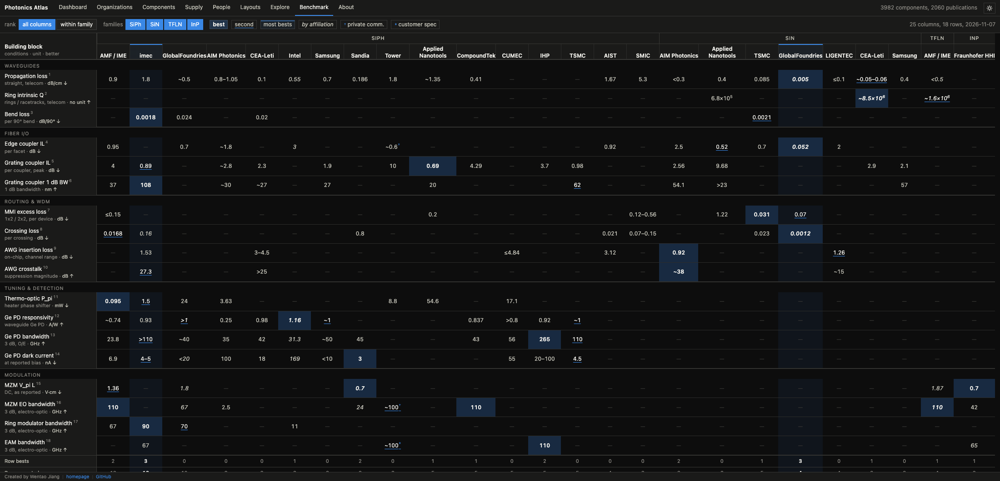
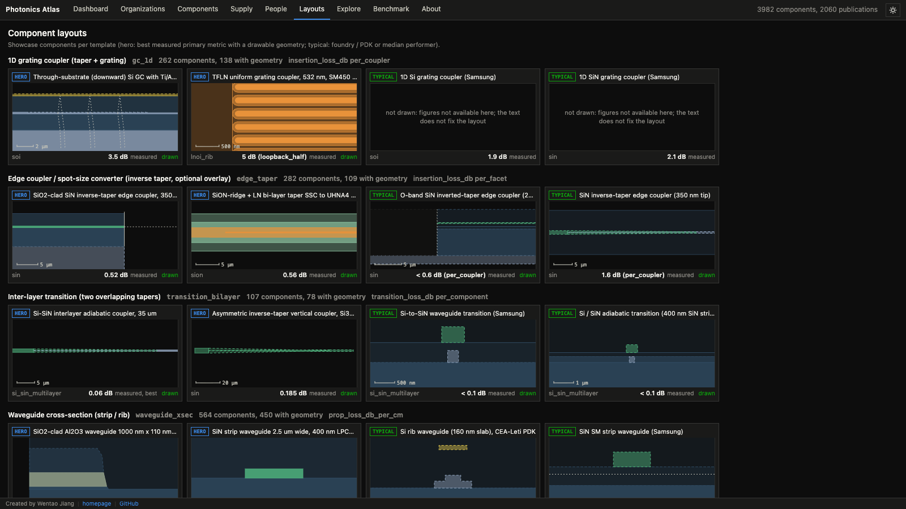
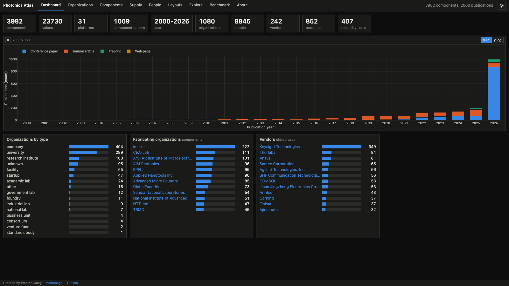

# Photonics Atlas

A traceable atlas of integrated photonics built from published work: PIC components with their reported performance
and geometry, a foundry PDK benchmark, the supply chain behind them, and the people and organizations that publish
them. Live at https://outside5sigma.com/photonics-atlas/.







- **PIC components** (couplers, splitters, resonators, WDM, phase shifters, detectors, lasers, amplifiers, ...):
  long-format values with conditions, scope, basis and locator, per-class tables, plots and true-scale layouts;
- **foundry PDK benchmark**: foundry x platform columns, building-block rows, the best published value per cell with
  its provenance on hover; also a self-contained page (`app/static/pdk-benchmark.html`);
- **supply chain / vendors** (wafers, foundries, lasers, fiber and connectors, packaging materials and tools, test
  instruments, reliability standards);
- **people / affiliations** (absorbs the photonics lineage graph) on a shared registry of organizations, org events and
  source documents.

All of it is one SvelteKit static app (GitHub Pages, built by `.github/workflows/deploy.yml` on every push to `main`).
The [EO modulator atlas](https://github.com/jwt625/eo-modulator-atlas) and the
[advanced packaging atlas](https://github.com/jwt625/advanced-packaging-atlas) stay canonical for their own tables;
this repo reads them through read-only adapters and maps their organizations into the shared registry.

## Current state (2026-11-07)

- Counts (computed by `scripts/build_views.py` from the tables): 3982 components (101 classes in 20 families, 31
  platforms) with 23730 values (7165 measured) from 1009 publications, years 2000-2026; 1080 organizations; 8845
  public people with 16115 published affiliations in 1975 publications; supply: 1997 stated uses, 242 vendors, 852
  products, 39 foundry processes, 24 standards, 407 reliability tests; 2060 publications cited in all.
- Foundations: shared registry of organizations, org events and source documents
  ([DevLog-001](DevLog/DevLog-001-p0-foundation.md)); component atlas with a per-class parameter registry
  ([DevLog-002](DevLog/DevLog-002-p1-component-atlas.md)); supply chain ([DevLog-003](DevLog/DevLog-003-p2-supply-chain.md));
  people and dated affiliation observations ([DevLog-004](DevLog/DevLog-004-p3-people.md); review queue and derived
  transitions stay local and git-ignored).
- Literature corpus: a scored, curated list of about a thousand papers (OpenAlex / Crossref / arXiv harvest, owner
  adds), fetched politely, extracted to page-marked text and figure renders, registered as `lit:` sources
  ([DevLog-006](DevLog/DevLog-006-literature-scouting.md)); OFC 2026 papers and author headers
  ([DevLog-008](DevLog/DevLog-008-ofc-header-extraction.md), [DevLog-011](DevLog/DevLog-011-lit-author-affiliations.md)).
- Distillation: every paper goes through a distill agent and an independent fresh-context audit before merge; audit
  corrections are replayable `patch.yaml` files per staging batch ([DevLog-007](DevLog/DevLog-007-lit-distill.md)).
- App ([DevLog-010](DevLog/DevLog-010-views-and-org-hub.md), [DevLog-012](DevLog/DevLog-012-load-performance.md),
  [DevLog-013](DevLog/DevLog-013-ui-tables-and-layouts.md)): dashboard, organizations and org hub, per-class
  component tables with column filters, explore plots, curated true-scale layouts (a layout the source does not fix
  is not drawn), supply, people. Viewer-facing: sources are shown as publications; no pipeline fields are served.
- Foundry PDK benchmark ([DevLog-014](DevLog/DevLog-014-pdk-benchmark-table.md),
  [DevLog-015](DevLog/DevLog-015-foundry-coverage-tsmc-tower.md)): 25 foundry x platform columns (SiPh, SiN, TFLN,
  InP), 18 rows; rules and choices in `config/benchmark.yaml` (basis filter, telecom window, ranges ranked at their
  midpoint, pinned columns, foundry by author affiliation when a paper names no fab, marked customer-spec and
  private-communication values).

## Data conventions

Schema and binding rules: [data/schema/registry.schema.yaml](data/schema/registry.schema.yaml). In short: empty cell =
not stated by any source; renames, spin-offs, acquisitions and mergers are events between separate organizations,
never aliases; printed strings map by normalized name, curated alias or exact ROR name match (no fuzzy matching);
ISO dates (`YYYY`, `YYYY-MM`, `YYYY-MM-DD`); evidence grades A-D, X. Non-open-access sources contribute facts and
locators only: cached PDFs, extracted text and figure renders stay local and git-ignored (`references/*/source.json`
metadata is committed).

## Workflow

Python 3.12 with [uv](https://docs.astral.sh/uv/):

```sh
uv sync --extra dev
uv run python scripts/validate_db.py
uv run pytest -q
uv run ruff check . && uv run mypy
```

Building the registry needs the input repos next to this one (paths in `config/inputs.yaml`, relative to the parent
directory; override with `PHOTONICS_ATLAS_INPUTS_ROOT`) and the pinned ROR data dump (CC0; version in
`config/inputs.yaml`, Zenodo record 23500708) unpacked in `cache/ror/`. Writers support `--dry-run` and write
timestamped logs plus JSONL progress to `logs/`. The registry is curated data, not a from-scratch build: every hand
decision lives in a config file (`config/org_seed_overrides.yaml`, `config/org_curation_overrides.yaml`,
`config/event_participant_map.yaml`, `config/registry_corrections.yaml`). Run in this order:

| step | script | writes |
|---|---|---|
| 1 | `seed_org_registry.py` | appends new EO / packaging / lineage orgs and aliases (existing rows untouched) |
| 2 | `add_ror_orgs.py` | appends orgs/aliases resolved through ROR; writes the unmapped OFC strings to `data/_staging/org_curation/unmapped_<run>.csv` |
| 3 | `merge_org_curation.py` | appends reviewed curation decisions (`data/_staging/org_curation/batch_*/decisions.csv`); regenerates `skipped.csv` |
| 4 | `build_sources.py` | regenerates the eo/pk/ofc2026/blog/lin rows of `sources.csv`; keeps rows of other corpora (web, ds) |
| 5 | `merge_org_events.py` | regenerates `org_events.csv` / participants from lineage + staged research (hand-added event ids are kept), appends orgs it needs, replaces the web rows of `sources.csv` (cited sources only); needs step 4 |
| 6 | `apply_registry_corrections.py` | applies `config/registry_corrections.yaml` in place (idempotent) |
| 7 | `build_org_crosswalk.py` | regenerates `data/crosswalk/org_crosswalk.csv`; exit 1 when the P0 acceptance fails |
| 8 | `build_views.py` | regenerates `app/static/data/{registry,components,supply,people}.json` (committed; the Pages build serves them; people: public rows only) |

Atlas tranches on top of the registry (each validated by `validate_db.py` through its schema file and rules module):

| script | writes |
|---|---|
| `scan_component_candidates.py`, `scan_ofc_candidates.py` | candidate lists and batch files in `data/_staging/components/` |
| `merge_component_staging.py <batch>` | appends a validated distillation batch to `data/components/` (`--replace` for patched batches) |
| `patch_component_staging.py <batch> <patch.yaml>` | applies coordinator / audit corrections to a staging batch (idempotent) |
| `build_supply_seed.py` | append-only supply tables in `data/supply/` from EO papers and packaging metrics (`data/supply/curation.yaml`) |
| `scan_vendor_models.py` | vendor / model candidates from cached paper texts (`config/supply_scanner.yaml`): git-ignored JSONL with context in `data/_local/supply/scan/`, text-free `candidates.csv` per batch in `data/_staging/supply/products/<batch>/` |
| `build_supply_staging.py <batch>` | reviewed batch (`review.csv`) -> staged `products.csv` / `product_usage.csv` with page checks and validation; vendor gaps to `data/_staging/supply/org_requests.csv`; `--merge` appends to `data/supply/` (after audit) |
| `build_people.py`, then `derive_transitions.py` | people tables in `data/people/`; review queue and transitions in git-ignored `data/_local/people/` |

Literature and benchmark:

| script | writes |
|---|---|
| `lit_curator_adds.py`, `lit_select.py --delta`, `lit_build_queue.py --delta` | curated cache list and retrieval queue in `data/_staging/literature/` (previous rows kept verbatim) |
| `lit_fetch_oa.py`, `lit_fetch_browser.py`, `lit_ingest_inbox.py`, `lit_extract.py` | `references/<paper_id>/` (PDF, `text.md`, figures; only `source.json` is committed) |
| `lit_register_sources.py` | `lit:` rows of `data/registry/sources.csv` |
| `build_benchmark.py` | `app/static/data/benchmark.json` from `config/benchmark.yaml`; then `cd app && node scripts/build-benchmark-html.mjs` for the standalone page |

`validate_db.py` (reader) checks everything against the schema.

App (Node 22+, pnpm):

```sh
cd app
pnpm install
pnpm dev        # or: pnpm check && pnpm test && pnpm build
```

## Rights

Registry data: facts with source locators. ROR data is CC0. Source documents keep their own rights; see `access`,
`license` and `redistribution` in `sources.csv`.
